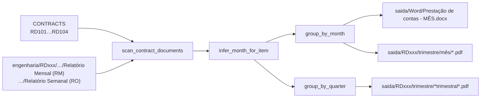

# Prestação de Contas — Relatórios RM/RO

> **Summary in English.** Python automation that scans the engineering folders of each road project, finds the
> monthly (RM) and weekly (RO) site reports, infers the month of each one (file name, folder, report sequence or
> modification date), and produces: one consolidated Word report per month listing every report by road, plus
> monthly and quarterly merged PDFs per road (quarters counted from each contract's start month). Built by Emmily
> Maciel for accountability reporting in a road-infrastructure program; this public copy is sanitized and ships a
> fictitious data generator.

## Problema

A prestação de contas trimestral exigia juntar, para cada rodovia, todos os relatórios mensais e semanais de obra
do período — espalhados em pastas sincronizadas do SharePoint, com nomes fora de padrão — num PDF por mês e por
trimestre, além de um Word com a relação do que foi entregue. Os trimestres não coincidem com o calendário: contam a
partir do início de cada contrato.

## Solução

- `ContractConfig` por rodovia (mês de início, pasta mensal, pasta semanal, saída).
- Detecção RM/RO pelo nome e, em último caso, pela pasta; mês inferido em cascata: texto do nome → pasta →
  sequencial do RM a partir do início da obra → data de modificação.
- Junção de PDFs com `pypdf` (só concatena páginas, preserva o original) e anexos de RM incluídos.
- Word mensal com tabela por rodovia (python-docx).
- Libera espaço local de arquivos da nuvem após ler (`attrib +U -P`, no Windows; não apaga nada da nuvem).

## Arquitetura



## Números

| Indicador | Valor | Fonte |
|---|---|---|
| Código | ~1 mil linhas | código |
| Rodovias configuradas | 4 | código |
| Volume do acervo de saída no uso real | ~2 GB de PDFs | STATE do projeto privado |
| Tempo economizado | `[a confirmar pela autora]` | — |

## Como rodar (dados fictícios)

```bat
py -m pip install -r requirements_prestacao_contas.txt
py examples\gerar_exemplo.py
py prestacao_contas_relatorios.py --roads RD101 RD103
```

O exemplo cria PDFs em branco de nomes inventados em `examples\engenharia\`; a saída vai para `saida\`
(Word mensais, PDFs mensais e trimestrais, logs). Variáveis: `PRESTACAO_BASE_DIR`, `PRESTACAO_SAIDA_DIR`.
README de trabalho original (sanitizado): [`docs/README-original-sanitizado.md`](docs/README-original-sanitizado.md).

## O que eu decidi × o que a IA gerou

| Eu (Emmily) decidi | Gerado com apoio de IA, sob minha revisão |
|---|---|
| Trimestres contados a partir do início de cada contrato, não do calendário | Expressões regulares de data e a cascata de inferência de mês |
| Saída: Word mensal + PDF mensal e trimestral por rodovia, organizados em pastas | Junção de PDFs, montagem do Word e logs |
| Liberar espaço local após ler cada PDF (acervo grande em pasta sincronizada) | `[a confirmar pela autora]` — divisão fina |

## Stack

Python 3.10+ · pypdf · python-docx

## Verificação, sanitização e licença

- **Testes:** sem suíte automatizada; execução ponta a ponta com os dados fictícios conferida em 18/11/2026 (passos em "Como rodar").
- **Dados:** fictícios — cópia sanitizada de um sistema em uso real; nenhum dado de cliente ou de terceiro.
- **Sanitização:** o que foi removido, trocado ou inventado nesta cópia está em [`SANITIZACAO.md`](SANITIZACAO.md).
- **Licença:** todos os direitos reservados; leitura permitida para avaliação de portfólio — ver [`LICENSE`](LICENSE) e [`NOTICE`](NOTICE).

## Aviso

*Dados fictícios. Versão sanitizada de um sistema em uso real; identificadores do cliente foram substituídos.*
Rodovias aparecem como RD101…RD104.

Autora: **Emmily Maciel** — [github.com/Emmilymaciell](https://github.com/Emmilymaciell)
